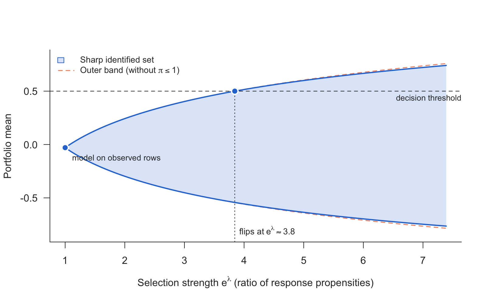
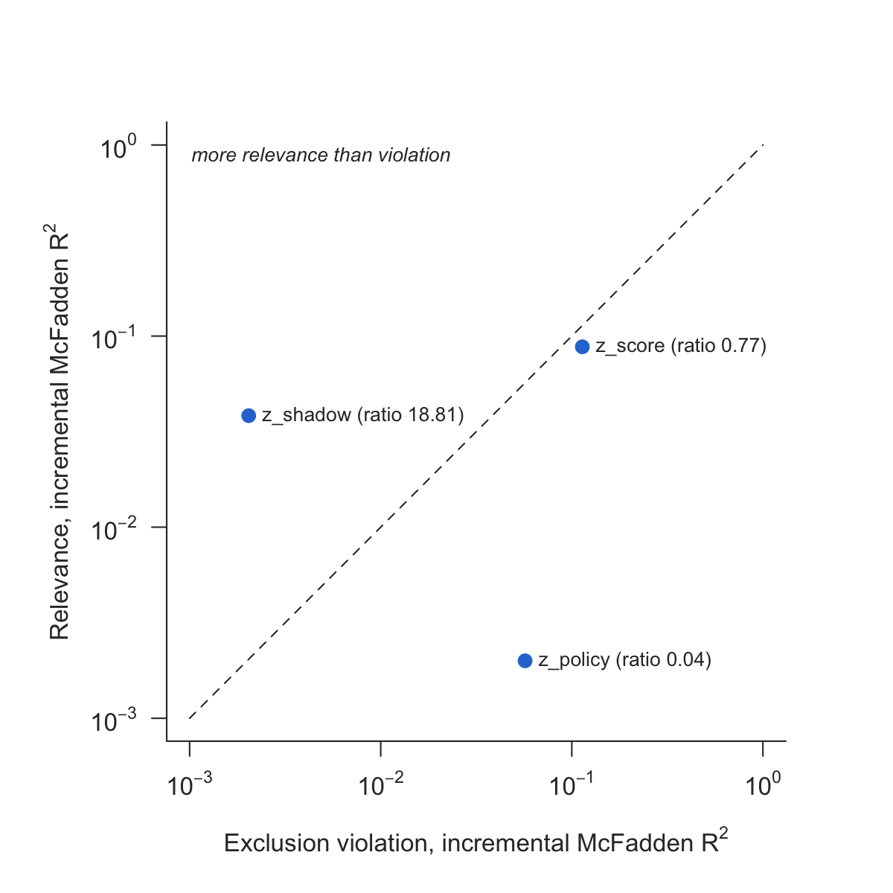

# shadowscan

If a binary outcome is missing not at random, as defaults are for rejected
credit applications, every model fitted on the observed rows silently asserts
*one* value for how observability depends on the outcome. Nothing in the data
selects it. `shadowscan` provides two tools for two different questions:

- **`shadow_screen()`**: *is this variable fit to serve as a shadow variable?*
  It puts relevance for the outcome against violation of the exclusion
  restriction, both as incremental McFadden R², on one scale.
- **`shadow_scan()`** and **`shadow_scan_mean()`**: *how far can the answer
  move?* They return the sharp identified set under a bound e^λ on the ratio
  of response propensities between outcome values (a risk ratio, not an odds
  ratio), with no shadow variable needed. The first handles a binary outcome
  in closed form, the second the mean of any outcome from a grid of
  conditional quantiles.

The two rest on different assumptions and are **not** two halves of one
procedure.

## Installation

```r
# install.packages("remotes")
remotes::install_github("mchlbckr/shadowscan")
```

## The scan

The scan takes two numeric vectors evaluated at the rows of interest:
η̂_obs(x) = P(Y = 1 | X = x, R = 1) and the *conditional* observation rate
r̂(x) = P(R = 1 | X = x). Any learner can produce them. The set is

$$\mathcal H_\lambda(x) = \big[\max\{\mathrm{expit}(\ell-\lambda),\, r\eta_{\mathrm{obs}}\},\; \min\{\mathrm{expit}(\ell+\lambda),\, r\eta_{\mathrm{obs}} + 1 - r\}\big],\quad \ell = \mathrm{logit}\,\eta_{\mathrm{obs}},$$

the naive band intersected with the worst-case bounds.

```r
library(shadowscan)
d   <- simulate_shadow(5000, tilt = -1, seed = 1)
rej <- d[d$observed == 0, ]
s   <- shadow_scan(rej$eta_obs, rej$obs_rate, threshold = 0.35)
s
plot(s)
```


The sharp set is never wider than the naive band. Where r̂ is small, as for
rejected applications, its upper edge coincides with the naive one; it is
narrower only where a worst-case bound cuts the band. The default aggregation
averages each row's own bounds, which is sharp under the pointwise assumption.
`aggregate = "common"` adds the assumption of one tilt for all rows. That set
is narrower but is bounded by the most extreme rows, so with estimated inputs
it inherits their estimation error. The help page explains how to read it.

## The scan for a mean

For an outcome that is not binary, `shadow_scan_mean()` takes, per row, a grid
of conditional quantiles of Y given R = 1 and X, together with r̂(x). It
returns the sharp set for the mean under the same assumption. Binary input
reproduces `shadow_scan()` exactly.

```r
dc  <- simulate_shadow(3000, tilt = -1, outcome = "continuous", seed = 1)
q   <- obs_quantiles(dc, K = 200)       # n x K, levels (k - 1/2)/K
rej <- dc$observed == 0
sm  <- shadow_scan_mean(q[rej, ], dc$obs_rate[rej], threshold = 0.5)
plot(sm)
```



## The screen

```r
sc <- shadow_screen(d, outcome = "y", response = "observed",
                    covariates = c("x1", "x2"),
                    candidates = c("z_shadow", "z_policy", "z_score"))
sc
plot(sc)
```



## Scope

The scan covers a binary outcome in closed form and the **mean** of any
outcome with a finite mean. It does not cover quantiles or the whole
distribution. The screen's measure, incremental McFadden R², presumes a
discrete outcome. Covariates, learners and sample size are unrestricted. The package
contains no estimator and fits neither η_obs nor r. The sets are identified sets: estimated inputs are treated as known, and no
confidence sets are offered. It ships no outside data:
examples and tests run on `simulate_shadow()`.

## License

MIT
