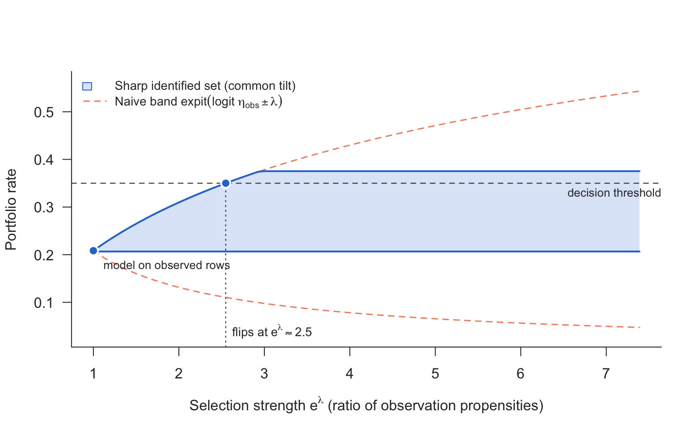

# shadowscan

If a binary outcome is missing not at random, as defaults are for rejected
credit applications, every model fitted on the observed rows silently asserts
*one* value for how observability depends on the outcome. Nothing in the data
selects it. `shadowscan` provides two tools for two different questions:

- **`shadow_screen()`**: *is this variable fit to serve as a shadow variable?*
  It puts relevance for the outcome against violation of the exclusion
  restriction, both as incremental McFadden R², on one scale.
- **`shadow_scan()`**: *how far can the answer move?* It returns the sharp
  identified set under a bound |b(x)| ≤ λ on the logit tilt of selection,
  in closed form, with no shadow variable needed.

The two rest on different assumptions and are **not** two halves of one
procedure.

## Installation

```r
# install.packages("remotes")
remotes::install_github("mchlbckr/shadowscan")
```

## The scan

The scan takes two numeric vectors evaluated at the rows of interest:
η̂_obs(x) = P(Y = 1 | X = x, R = 1) and the *conditional* observation rate
r̂(x) = P(R = 1 | X = x). Any learner can produce them. The set is

$$\mathcal H_\lambda(x) = \big[\max\{\mathrm{expit}(\ell-\lambda),\, r\eta_{\mathrm{obs}}\},\; \min\{\mathrm{expit}(\ell+\lambda),\, r\eta_{\mathrm{obs}} + 1 - r\}\big],\quad \ell = \mathrm{logit}\,\eta_{\mathrm{obs}},$$

the naive band intersected with the worst-case bounds.

```r
library(shadowscan)
d   <- simulate_shadow(5000, tilt = -1, seed = 1)
rej <- d[d$observed == 0, ]
s   <- shadow_scan(rej$eta_obs, rej$obs_rate, threshold = 0.35)
s
plot(s)
```



The sharp set is never wider than the naive band. Where r̂ is small, as for
rejected applications, its upper edge coincides with the naive one; it is
narrower only where a worst-case bound cuts the band. With one common tilt for
all rows (the default), the most extreme rows bound the admissible tilt, which
produces the plateau above. The help page explains how to read it.

## The screen

```r
sc <- shadow_screen(d, outcome = "y", response = "observed",
                    covariates = c("x1", "x2"),
                    candidates = c("z_shadow", "z_policy", "z_score"))
sc
plot(sc)
```


## Scope

Version one handles a **binary** outcome only. For the scan this is not a
choice of the package. For a continuous outcome the sharp set is an open
question. Covariates, learners and sample size are unrestricted. The package
contains no estimator and fits neither η_obs nor r. It ships no outside data:
examples and tests run on `simulate_shadow()`.

## License

MIT
