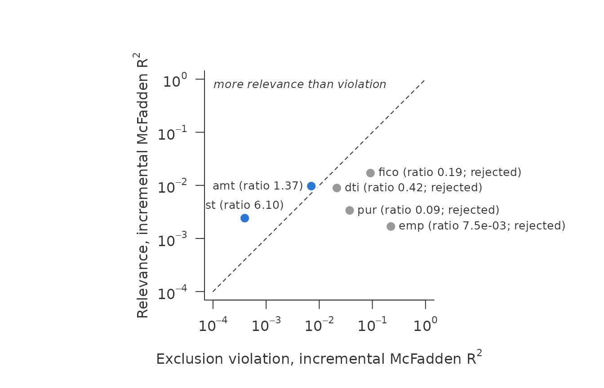
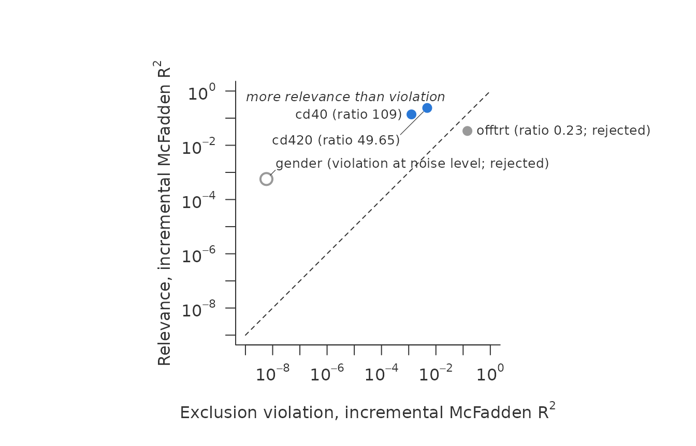
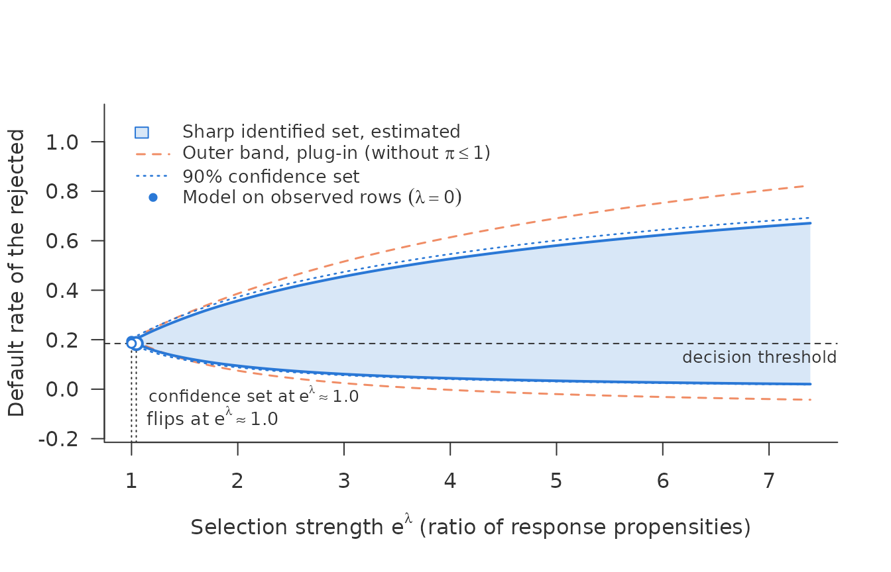
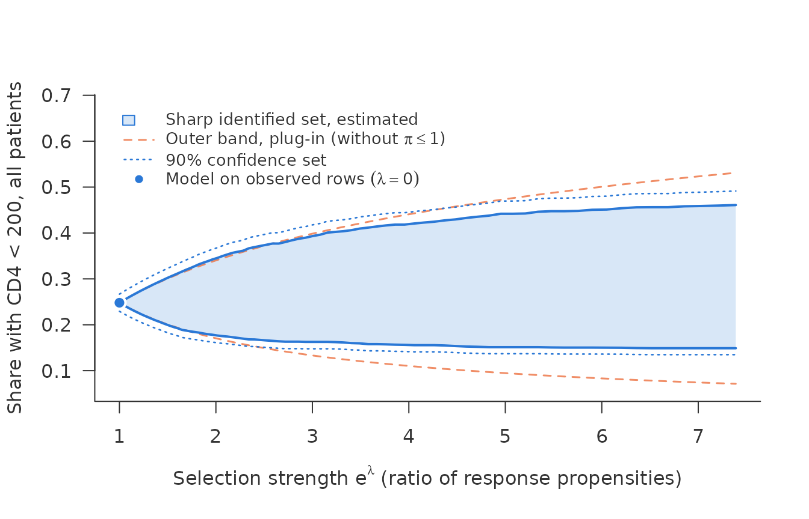
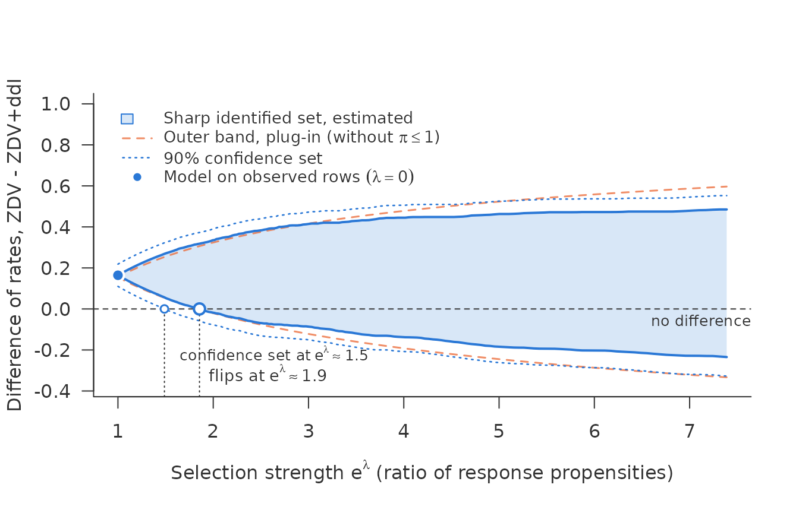
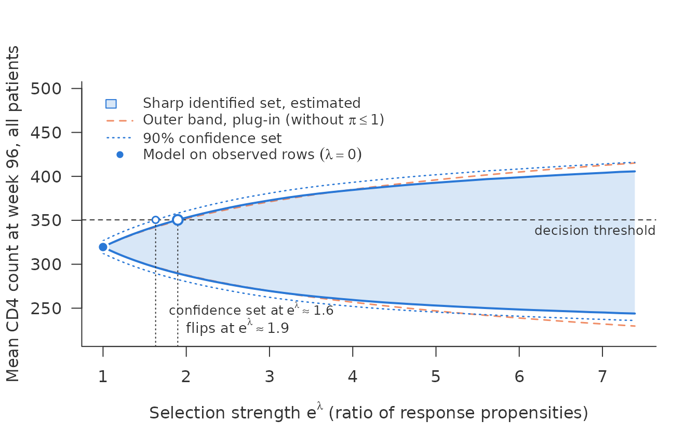
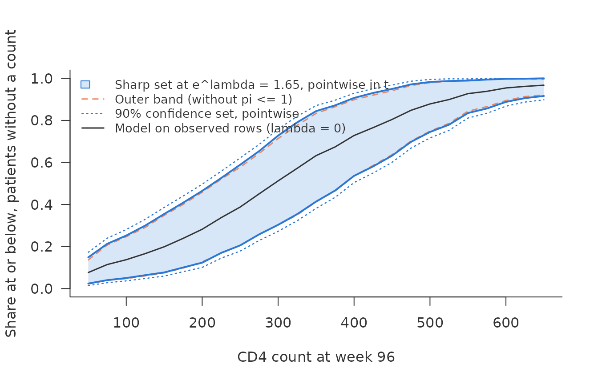

# Two applications: reject inference and trial dropout

The same question comes up wherever an outcome is missing for a reason
that may involve the outcome itself. This vignette takes two settings
that differ in almost every respect:

- **Reject inference.** Lending Club, 2014. A lender never learns
  whether a rejected applicant would have repaid, and it rejected them
  because it expected them not to.
- **Dropout in a clinical trial.** The AIDS Clinical Trials Group Study
  175 (Hammer et al., 1996). The CD4 count at week 96 is missing for
  patients who left the trial, plausibly those who did worse. In this
  literature the shadow variable is usually called a *nonresponse
  instrument* (Scharfstein, Rotnitzky and Robins, 1999; Zhao, Wang and
  Shao, 2021; Beppu and Morikawa, 2024; Chen and Shao, 2025).

Each step below is run on both, side by side.
[`vignette("nonignorable")`](https://mchlbckr.github.io/nonignorable/articles/nonignorable.md)
explains the tools on simulated data.

## The data

**Lending Club.** The data have 1,839,397 rows, and cross-fitting the
models takes 36 minutes. The Lending Club part therefore does not
compute. It reads small result objects shipped with the package. How to
recompute them is shown at the end.

Lending Club published both its granted loans and the applications it
rejected. The two files share a few characteristics: FICO score,
debt-to-income ratio (DTI), amount, employment length, state and
purpose. For 2014 there are 223,102 granted loans with a known outcome
and 1,616,295 rejections. \\Y = 1\\ is a default, and \\R = 1\\ means
the loan was granted.

**ACTG 175** ships with the package speff2trial and is small enough to
compute here.

``` r

data(ACTG175, package = "speff2trial")
d <- ACTG175
d$arms <- factor(d$arms, 0:3, c("ZDV", "ZDV+ddI", "ZDV+Zal", "ddI"))
d$y <- as.integer(d$cd496 < 200)
table(arm = d$arms, observed = d$r)
#>          observed
#> arm         0   1
#>   ZDV     211 321
#>   ZDV+ddI 189 333
#>   ZDV+Zal 187 337
#>   ddI     210 351
```

2139 patients with HIV were randomised to four antiretroviral regimens.
The CD4 count at week 96 is missing for 797 patients (37%). \\Y = 1\\ is
a count below 200, the clinical threshold for AIDS. One caveat: for 39%
of the patients without a week-96 count, follow-up ended before week 96.
Some of them died, and for them the count is not missing but undefined.
The analysis follows the literature and treats all of them as missing.

## The screen

### Lending Club: the coding matters

[`shadow_screen()`](https://mchlbckr.github.io/nonignorable/reference/shadow_screen.md)
takes each of the six characteristics in turn as candidate, with the
other five as covariates. With numeric characteristics entered linearly:

``` r

lc$screen_linear
#> <shadow_screen> relevance vs exclusion violation, incremental McFadden R^2
#>   pass: relevance chi2/df >= 10 and ratio > 1
#>  candidate relevance exclusion   ratio chi2/df verdict          
#>  fico         0.0171     0.018   0.951    3645 reject: exclusion
#>  dti         0.00931   0.00219    4.25    1987 pass             
#>  amt         0.00708   0.00435    1.63    1511 pass             
#>  emp         0.00155     0.382 0.00405      30 reject: exclusion
#>  st          0.00241  0.000483       5    11.2 pass             
#>  pur          0.0031     0.062    0.05    60.2 reject: exclusion
```

Passing: DTI, amount and state. But Lending Club cut hard. No
application with a FICO score below 662 or a DTI of 40 or more was
granted. A linear term cannot represent such a step, so it understates
how strongly FICO and DTI drive the decision. Coded as ten classes of
equal mass, the picture changes:

``` r

lc$screen_deciles
#> <shadow_screen> relevance vs exclusion violation, incremental McFadden R^2
#>   pass: relevance chi2/df >= 10 and ratio > 1
#>  candidate relevance exclusion   ratio chi2/df verdict          
#>  fico          0.017    0.0904   0.188     402 reject: exclusion
#>  dti         0.00915    0.0215   0.426     217 reject: exclusion
#>  amt         0.00909    0.0116   0.786     216 reject: exclusion
#>  emp         0.00166     0.223 0.00745    32.3 reject: exclusion
#>  st           0.0024  0.000431    5.57    11.1 pass             
#>  pur         0.00335    0.0381  0.0879    64.9 reject: exclusion
```

Now only state passes. Amount fails, with a ratio of 0.79. Amount has a
further problem. Loan amounts are heaped on round numbers, and many rows
sit exactly on a decile boundary, so classes cut at quantiles split
those atoms arbitrarily. `numeric = "classes"` cuts only between
distinct values:

``` r

lc$screen_classes
#> <shadow_screen> relevance vs exclusion violation, incremental McFadden R^2
#>   pass: relevance chi2/df >= 10 and ratio > 1
#>  candidate relevance exclusion   ratio chi2/df verdict          
#>  fico         0.0171     0.092   0.186     455 reject: exclusion
#>  dti         0.00892    0.0214   0.417     211 reject: exclusion
#>  amt          0.0097   0.00709    1.37     259 pass             
#>  emp         0.00168     0.223 0.00753    32.6 reject: exclusion
#>  st          0.00242  0.000396     6.1    11.2 pass             
#>  pur         0.00337    0.0373  0.0903    65.4 reject: exclusion
plot(lc$screen_classes)
```



Passing now: amount and state. Amount has a ratio of 1.37, DTI of 0.42.
The lesson is not that amount is a good shadow variable. It is that the
answer depends on the coding, and that a threshold rule in the selection
calls for classes.

### ACTG 175: a clear shadow variable and a clear violation

The covariates are baseline characteristics and the CD8 count at
baseline. The candidates are the CD4 counts at baseline (`cd40`) and at
week 20 (`cd420`), sex, and `offtrt`, an indicator that the patient
stopped the assigned treatment before week 96.

Here the numeric characteristics enter linearly. Dropout follows no
threshold rule, and the screen finds no trace of one. Classes would also
cost more than the data carry: with 309 counts below 200 among the
observed, ten classes for each numeric characteristic leave fewer than
ten of them per parameter, and the screen warns about exactly that.
Flexible coding pays when the selection uses a threshold and the sample
carries the degrees of freedom.

``` r

base <- c("age", "wtkg", "hemo", "homo", "drugs", "karnof", "race",
          "symptom", "str2", "preanti", "arms", "cd80")
sc <- shadow_screen(d, outcome = "y", response = "r", covariates = base,
                    candidates = c("cd40", "cd420", "gender", "offtrt"))
sc
#> <shadow_screen> relevance vs exclusion violation, incremental McFadden R^2
#>   pass: relevance chi2/df >= 10 and ratio > 1
#>   numeric as linear terms: age, wtkg, karnof, preanti, cd80, cd40, cd420
#>  candidate relevance exclusion ratio chi2/df verdict          
#>  cd40          0.138   0.00126   109     199 pass             
#>  cd420         0.238   0.00479  49.6     345 pass             
#>  gender     0.000569   5.9e-09 96463   0.825 reject: weak     
#>  offtrt       0.0337     0.144 0.235    48.8 reject: exclusion
#>   violation at noise level (exclusion chi2/df below 1; the ratio
#>     divides by noise): gender
plot(sc)
```



- **The earlier CD4 counts pass clearly.** The count at week 20 predicts
  the count at week 96 far better than it predicts dropout, with a ratio
  of 49.65.
- **Sex is too weak.** Its relevance has a \\\chi^2/\mathrm{df}\\ of
  0.82. It has been used as an instrument in this literature, but on
  these data it carries almost no information about the outcome. Its
  point in the plot is hollow: its exclusion \\\chi^2/\mathrm{df}\\ is
  1.7e-05, below the noise floor of 1, so its ratio divides by noise and
  is not reported.
- **Stopping treatment violates the exclusion restriction.** It is
  strongly relevant, but its ratio is 0.23: it predicts dropout more
  strongly still. It plays the part a bureau score plays in reject
  inference.

## The scan

### Lending Club: is the rejected portfolio riskier?

A lender asks whether its rejected applicants really are riskier than
the ones it granted: whether their own default rate, \\E(Y \mid R =
0)\\, exceeds that of the granted loans. With `target = "unobserved"`
the scan bounds that rate. It is not the average of \\\eta(x)\\ at the
rejected applicants’ characteristics: under selection on the outcome the
rejected at a given \\x\\ differ from all applicants at that \\x\\. The
decision threshold is the default rate of the granted loans, 0.184. It
is itself an estimate and is treated as fixed here. Rows with a FICO
below 662 or a DTI of 40 or more were never granted. There \\r(x) = 0\\,
the data say nothing, and these rows leave the analysis. That leaves the
overlap region, FICO \>= 662 and DTI \< 40, with 223,102 granted and
438,588 rejected applications. Both models are logistic with natural
splines for the numeric characteristics, cross-fitted with 5 folds.

``` r

lc$scan_ci
#> <sharp_scan_ci> sharp set for a rate, debiased, with 90% confidence set
#>   rows: 661690   target: unobserved (438588 rows)
#>   r-hat < 0.01: 64159 target rows, 886 observed rows; smallest r-hat observed 0.00031
#>   lambda = 0: 0.194 [0.183, 0.204]
#>   lambda = 2 (propensity ratio 7.39): set [0.0205, 0.671], confidence set [0.0184, 0.693]
#>   threshold 0.184 reached by
#>     estimated set:        lambda = 0.0436 (propensity ratio 1.04) 
#>     confidence set:       lambda = 0 (propensity ratio 1) 
#>     outer band (plug-in): lambda = 0.0799 (propensity ratio 1.08) 
#>   cap pi <= 1 at lambda = 2 binds in 46% of the rows entering the set
#>     for the lower bound, 34% for the upper
plot(lc$scan_ci, ylab = "Default rate of the rejected")
```



Under MAR the rejected would default at a rate of 0.194. That is above
the threshold, but not by much. The estimated set reaches the threshold
at a propensity ratio of 1.04. That end of the set is reached when
applicants who would default were more likely to be granted than
otherwise identical applicants who would repay, as can happen when the
score misses what a loan officer sees. They need to be only about 4%
more likely.

The confidence set is wider still. At \\\lambda = 0\\ it is \[0.183,
0.204\], which already contains the threshold. Even under MAR the data
cannot rule out that the rejected are as good as the granted. This is
with 661,690 rows. Three lines of the output explain why.

- **The rows with small \\\hat r\\.** 64,159 of the rejected rows have
  \\\hat r \< 0.01\\. What the data say about them rests on the 886
  granted rows of the same kind, each weighted by \\1/\hat r\\.
- **The standard error.** The default `se_type = "max"` takes the larger
  of two standard errors at each endpoint. Here the empirical one is
  larger, by a factor of 1.41 at \\\lambda = 0\\. The conditional one is
  computed from the fitted models and misses their misspecification. The
  empirical one sees it, but it can be unstable where \\\hat r\\ is
  small. Taking the larger guards against both.
- **The plug-in.** Without debiasing, the scan on the same cross-fitted
  inputs flips at 1.09.

Removing the rejected rows with \\\hat r \< 0.01\\ changes the question
to the better-covered part of the rejected portfolio. For it the
estimate flips at 1.09 and the confidence set at 1.06:

``` r

lc$scan_ci_trim
#> <sharp_scan_ci> sharp set for a rate, debiased, with 90% confidence set
#>   rows: 661690   target: unobserved (374429 rows)
#>   trimmed: 64159 rows with r-hat < 0.01, out of the target
#>   r-hat < 0.01: 0 target rows, 886 observed rows; smallest r-hat observed 0.00031
#>   lambda = 0: 0.204 [0.199, 0.209]
#>   lambda = 2 (propensity ratio 7.39): set [0.0199, 0.709], confidence set [0.0188, 0.719]
#>   threshold 0.184 reached by
#>     estimated set:        lambda = 0.0859 (propensity ratio 1.09) 
#>     confidence set:       lambda = 0.0626 (propensity ratio 1.06) 
#>     outer band (plug-in): lambda = 0.0854 (propensity ratio 1.09) 
#>   cap pi <= 1 at lambda = 2 binds in 51% of the rows entering the set
#>     for the lower bound, 37% for the upper
```

### ACTG 175: every patient had a fair chance of being observed

Both models are logistic on the baseline covariates and the two earlier
CD4 counts, cross-fitted with five folds. The rate of interest is the
share with CD4 below 200 among all patients.

``` r

rhs <- paste(c(base, "cd40", "cd420"), collapse = " + ")
fe <- as.formula(paste("y ~", rhs))
fr <- as.formula(paste("r ~", rhs))
inp <- crossfit_inputs(d, "r",
  fit_eta = function(train, new)
    predict(glm(fe, binomial, data = train[train$r == 1, ]), new, type = "response"),
  fit_r = function(train, new)
    predict(glm(fr, binomial, data = train), new, type = "response"),
  folds = 5, seed = 175)
yb <- ifelse(d$r == 1, d$y, NA)
summary(inp$r)
#>    Min. 1st Qu.  Median    Mean 3rd Qu.    Max. 
#>  0.2949  0.5693  0.6361  0.6263  0.6891  0.8697
all <- sharp_scan_ci(inp$eta_obs, inp$r, d$r, yb, target = "all")
all
#> <sharp_scan_ci> sharp set for a rate, debiased, with 90% confidence set
#>   rows: 2139   target: all (2139 rows)
#>   r-hat < 0.01: 0 target rows, 0 observed rows; smallest r-hat observed 0.33
#>   lambda = 0: 0.248 [0.229, 0.267]
#>   lambda = 2 (propensity ratio 7.39): set [0.149, 0.461], confidence set [0.135, 0.491]
#>   cap pi <= 1 at lambda = 2 binds in 98% of the rows entering the set
#>     for the lower bound, 61% for the upper
plot(all, ylab = "Share with CD4 < 200, all patients")
```



The estimated chance of a week-96 count ranges from 0.29 to 0.87. This
is the opposite of Lending Club, and it has two consequences.

- **The sharp set is much narrower than the outer band.** At a
  propensity ratio of 7.39 the outer band spans \[0.071, 0.531\], the
  sharp set only \[0.149, 0.461\]. Because every patient had a good
  chance of being observed, the observed share bounds what the missing
  ones can be.
- **Sampling error is moderate.** No row has \\\hat r \< 0.01\\, and the
  confidence set is only a little wider than the estimate.

## Comparing two groups

A trial is run for a comparison: is zidovudine alone worse than the
alternatives?
[`sharp_scan_contrast()`](https://mchlbckr.github.io/nonignorable/reference/sharp_scan_contrast.md)
scans the difference in the share with CD4 below 200 between two arms.
It reports the selection strength from which “no difference” can no
longer be ruled out.

``` r

others <- c("ZDV+ddI", "ZDV+Zal", "ddI")
k <- lapply(others, function(b)
  sharp_scan_contrast(inp$eta_obs, inp$r, d$r, yb,
                       target_a = d$arms == "ZDV", target_b = d$arms == b,
                       lambda = seq(0, 2, length.out = 201),
                       labels = c("ZDV", b)))
names(k) <- others
k[["ZDV+ddI"]]
#> <sharp_scan_contrast> difference of rates ZDV - ZDV+ddI, debiased, with 90% confidence set
#>   rows: 2139   ZDV: 532 rows   ZDV+ddI: 522 rows
#>   r-hat < 0.01: 0 target rows, 0 observed rows; smallest r-hat observed 0.33
#>   lambda = 0: 0.164 [0.11, 0.218]
#>   lambda = 2 (propensity ratio 7.39): set [-0.235, 0.485], confidence set [-0.328, 0.553]
#>   difference 0 reached by
#>     estimated set:        lambda = 0.618 (propensity ratio 1.86) 
#>     confidence set:       lambda = 0.397 (propensity ratio 1.49) 
#>     outer band (plug-in): lambda = 0.612 (propensity ratio 1.84)
plot(k[["ZDV+ddI"]])
```



``` r

data.frame(
  comparison = paste("ZDV -", others),
  mar = sapply(k, function(x) x$point),
  flip_estimate = sapply(k, function(x) exp(x$flip[["sharp"]])),
  flip_confidence = sapply(k, function(x) exp(x$flip[["ci"]])),
  row.names = NULL)
#>      comparison       mar flip_estimate flip_confidence
#> 1 ZDV - ZDV+ddI 0.1642672      1.855753        1.487798
#> 2 ZDV - ZDV+Zal 0.1299950      1.597500        1.308078
#> 3     ZDV - ddI 0.1134366      1.548126        1.253335
```

Under MAR, the share below 200 is 16.4 percentage points higher on
zidovudine alone than on zidovudine with didanosine. That finding holds
as long as the propensity ratio stays below 1.86. With sampling error it
holds up to 1.49.

The end of the set that reaches zero is the least favourable case for
the finding. On zidovudine alone, patients who would end below 200 are
that much *more* likely to have their count taken, which makes the arm
look worse than it is. With didanosine added, they are that much *less*
likely, which makes that arm look better. Selection would have to run in
opposite directions in the two arms, and with that strength, to undo the
comparison.

The same function compares any two groups chosen by \\X\\, such as two
regions of a lender. Each group is a whole segment of rows, observed and
unobserved alike. To compare only the rejected applicants of two
segments, set `among = "unobserved"`: it compares the default rates of
the rejected themselves, \\E(Y \mid R = 0)\\ in each segment.

## The mean of a continuous outcome

For the CD4 count itself rather than the share below 200,
[`sharp_scan_mean_ci()`](https://mchlbckr.github.io/nonignorable/reference/sharp_scan_mean_ci.md)
scans the mean count at week 96 over all patients, with a debiased
estimate and a confidence set. It needs, for every patient, a grid of
conditional quantiles of the count among the observed, fitted out of
fold.
[`crossfit_quantiles()`](https://mchlbckr.github.io/nonignorable/reference/crossfit_quantiles.md)
takes the learner as a function. Here it is a location-scale model from
mgcv for the square root of the count, smooth in the two earlier CD4
counts, with the quantiles of its standardised residuals; squaring the
quantiles brings them back to counts. The response model is the logistic
regression from above.

``` r

loc <- as.formula(paste("sqrt(cd496) ~",
                        paste(c(base, "s(cd40)", "s(cd420)"), collapse = " + ")))
fit_q <- function(train, new, tau) {
  m <- mgcv::gam(list(loc, ~ s(cd420)), family = mgcv::gaulss(), data = train)
  p_tr <- predict(m, train, type = "response")
  p_new <- predict(m, new, type = "response")
  e <- (sqrt(train$cd496) - p_tr[, 1]) * p_tr[, 2]   # standardised residuals
  pmax(outer(p_new[, 1], rep(1, length(tau))) +
       outer(1 / p_new[, 2], quantile(e, tau, names = FALSE)), 0)^2
}
cq <- crossfit_quantiles(d, "r", fit_q,
  fit_r = function(train, new)
    predict(glm(fr, binomial, data = train), new, type = "response"),
  K = 200, seed = 175)
baseline <- mean(d$cd40)
km <- sharp_scan_mean_ci(cq$q, cq$r, d$r, d$cd496, threshold = baseline)
km
#> <sharp_scan_mean_ci> sharp set for a mean, debiased, with 90% confidence set
#>   rows: 2139   target: all (2139 rows)
#>   r-hat < 0.01: 0 target rows, 0 observed rows; smallest r-hat observed 0.33
#>   lambda = 0: 320 [312, 327]
#>   lambda = 2 (propensity ratio 7.39): set [244, 406], confidence set [236, 416]
#>   threshold 351 reached by
#>     estimated set:        lambda = 0.641 (propensity ratio 1.9) 
#>     confidence set:       lambda = 0.49 (propensity ratio 1.63) 
#>     outer band (plug-in): lambda = 0.666 (propensity ratio 1.95) 
#>   cap pi <= 1 at lambda = 2 binds in 98% of the rows entering the set
#>     for the lower bound, 96% for the upper
plot(km, ylab = "Mean CD4 count at week 96, all patients")
```



Under MAR the mean count at week 96 is 320, below the mean at baseline
of 351. The threshold is that baseline mean: has the count fallen on
average? The baseline mean is itself an estimate, with a standard error
of 2.6, which the confidence set does not include. The answer survives
selection up to a propensity ratio of 1.90 in the estimate and 1.63 in
the confidence set. Beyond that, a dropout that hides the patients with
high counts could carry the mean back to its starting level. At a ratio
of \\e^1\\ the set is \[274, 368\]. The plug-in,
[`sharp_scan_mean()`](https://mchlbckr.github.io/nonignorable/reference/sharp_scan_mean.md)
on the same inputs, gives \[275, 365\]. It skips the correction terms,
and here it lies inside the debiased set, the direction in which the
plug-in typically errs.

## Quantiles of the missing counts

A mean can be moved by a few extreme counts. For the patients who left
the trial, the median count they would have had at week 96 is often the
more telling number.
[`sharp_scan_cdf()`](https://mchlbckr.github.io/nonignorable/reference/sharp_scan_cdf.md)
scans their distribution function, \\P(Y \le t \mid R = 0)\\, at each
value of a grid, and
[`quantile()`](https://rdrr.io/r/stats/quantile.html) turns it into
bounds for quantiles. It needs \\P(Y \le t \mid R = 1, X)\\ for every
patient and every \\t\\;
[`crossfit_cdf()`](https://mchlbckr.github.io/nonignorable/reference/crossfit_cdf.md)
fits it as one logistic regression of \\1(\text{count} \le t)\\ per
\\t\\, out of fold.

``` r

fz <- as.formula(paste("z ~", rhs))
tg <- seq(50, 650, by = 25)
cf <- suppressWarnings(crossfit_cdf(d, "r", "cd496", tg,
  fit_eta = function(train, new)
    predict(glm(fz, binomial, data = train), new, type = "response"),
  fit_r = function(train, new)
    predict(glm(fr, binomial, data = train), new, type = "response"),
  folds = 5, seed = 175))
kc <- sharp_scan_cdf(cf$eta_t, cf$r, d$r, d$cd496, t = tg, lambda = 0.5,
                     target = "unobserved")
plot(kc, xlab = "CD4 count at week 96",
     ylab = "Share at or below, patients without a count")
```



``` r

qc <- quantile(kc, c(0.25, 0.5, 0.75))
qc
#>   prob    point lower upper
#> 1 0.25 181.4208    75   275
#> 2 0.50 295.0239   200   400
#> 3 0.75 414.6244   300   525
```

Under MAR the patients without a count would have a median of about 295,
against 321 among those with one: the model already places them lower,
through their earlier counts. At a propensity ratio of 1.65 their median
lies between 200 and 400, at \\e^1\\ between 125 and 475. The quantile
bounds come from the two estimated curves and are widened outwards to
the grid of steps of 25; they carry no confidence statement.

Both the set and the dotted confidence set hold for each \\t\\
separately. No single law of the missing counts need reach the upper
curve at every \\t\\, so the curves are not a band for the whole
distribution.

## The two side by side

|  | Lending Club 2014 | ACTG 175 |
|:---|---:|---:|
| Rows | 661,690 | 2,139 |
| Observed | 223,102 | 1,342 |
| Smallest r-hat, observed rows | 0.00031 | 0.33 |
| Rows of interest with r-hat \< 0.01 | 64,159 | 0 |
| Finding | rejected riskier than granted | ZDV worse than ZDV+ddI |
| Distance from the threshold at lambda = 0 | 0.009 | 0.164 |
| Flip of the estimate | 1.04 | 1.86 |
| Flip of the confidence set | 1.00 | 1.49 |

Lending Club has about 310 times as many rows, yet its finding is the
fragile one. Two things decide this, and neither is the number of rows.

- **How far the finding is from the threshold.** Under MAR the rejected
  lie 0.009 above the threshold. The arms differ by 0.164. A small
  margin is crossed by weak selection. This drives the flip of the
  estimate.
- **How the selection treated the rows.** A lender that rejects most
  applicants is bound to leave rows that the data barely reach. Their
  weights \\1/\hat r\\ inflate the standard error, so on Lending Club
  the confidence set reaches the threshold already at MAR. A trial in
  which every patient had a fair chance of being measured does not have
  that problem.

## Recomputing the Lending Club objects

The source is the Kaggle dataset “All Lending Club loan data”
(wordsforthewise/lending-club, CC0 1.0), files
`accepted_2007_to_2018Q4.csv.gz` and `rejected_2007_to_2018Q4.csv.gz`.
The rejected file is restricted to 2014, and its `Risk_Score` column is
used as FICO. The code below outlines the computation. It is not run
here.

``` r

library(splines)
# d: one row per 2014 application, granted (R = 1, Y known) or rejected
# (R = 0), with fico, dti, amt, emp, st, pur.
vars <- c("fico", "dti", "amt", "emp", "st", "pur")
screen <- do.call(rbind, lapply(vars, function(z)
  as.data.frame(unclass(shadow_screen(d, "Y", "R", setdiff(vars, z), z,
                                      numeric = "classes")))))
ov <- d[d$fico >= 662 & d$dti < 40, ]
f <- ~ ns(fico, 4) + ns(dti, 4) + ns(log(amt), 4) + emp + st + pur
fit <- function(lhs) function(train, new)
  predict(glm(update(f, as.formula(paste(lhs, "~ ."))), binomial, data = train),
          new, type = "response")
inp <- crossfit_inputs(ov, "R", fit_eta = fit("Y"), fit_r = fit("R"),
                       folds = 5, seed = 2014)
ci <- sharp_scan_ci(inp$eta_obs, inp$r, ov$R, ov$Y, target = "unobserved",
                     lambda = seq(0, 2, length.out = 81), threshold = 0.1845)
```

The objects were built on 2026-11-06 with nonignorable 0.1.0.

## References

Beppu, K. and Morikawa, K. (2024). Verifiable identification condition
for nonignorable nonresponse data with categorical instrumental
variables. *Statistical Theory and Related Fields*, 8(1), 40–50.

Chen, J. and Shao, J. (2025). Instrument, variable and model selection
with nonignorable nonresponse. arXiv:2509.12557.

Hammer, S. M. et al. (1996). A trial comparing nucleoside monotherapy
with combination therapy in HIV-infected adults with CD4 cell counts
from 200 to 500 per cubic millimeter. *New England Journal of Medicine*,
335, 1081–1090.

Scharfstein, D. O., Rotnitzky, A. and Robins, J. M. (1999). Adjusting
for nonignorable drop-out using semiparametric nonresponse models.
*Journal of the American Statistical Association*, 94, 1096–1120.

Zhao, P., Wang, L. and Shao, J. (2021). Sufficient dimension reduction
and instrument search for data with nonignorable nonresponse.
*Bernoulli*, 27, 930–945.
