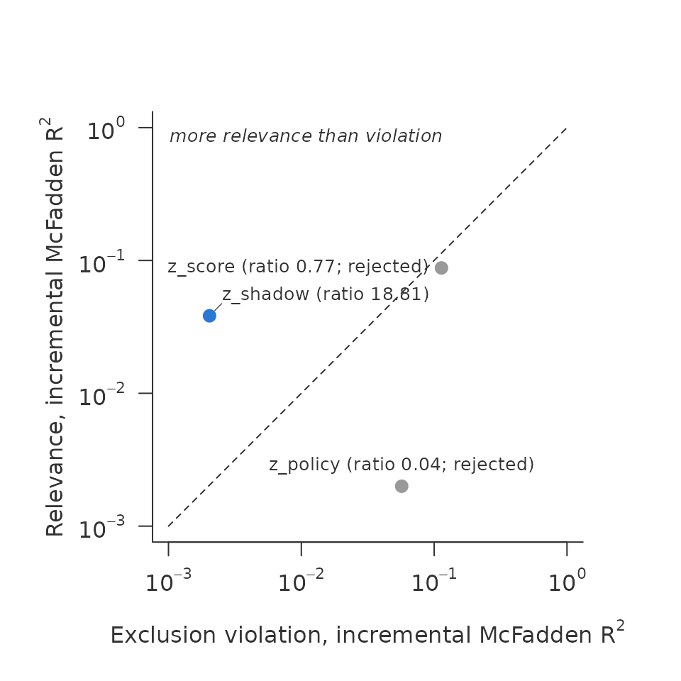
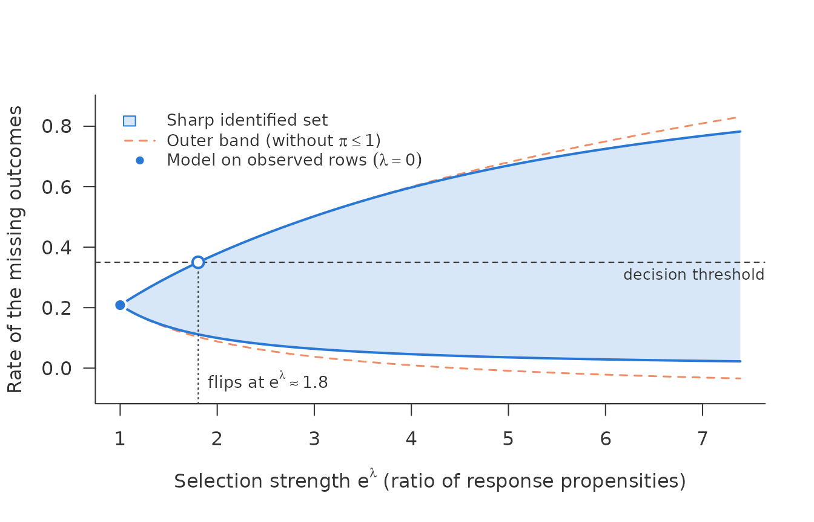
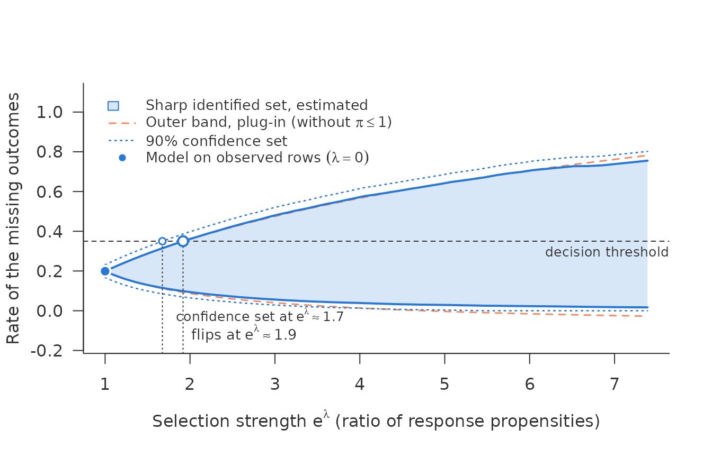
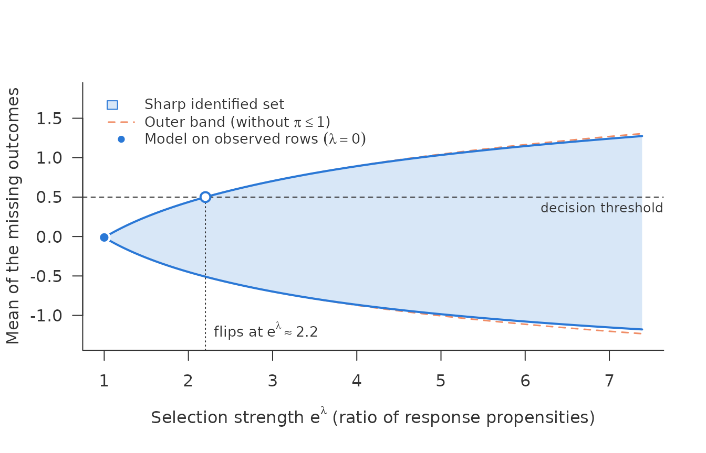
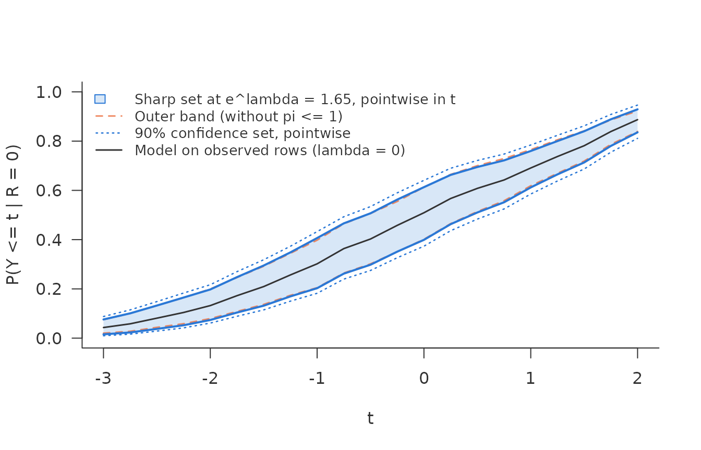
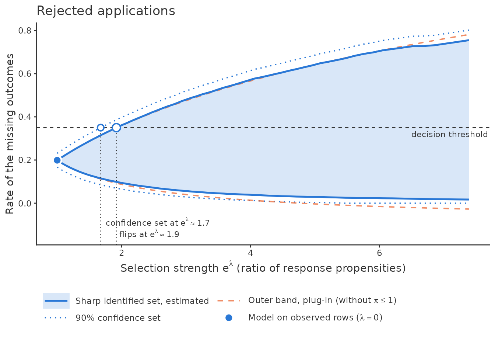
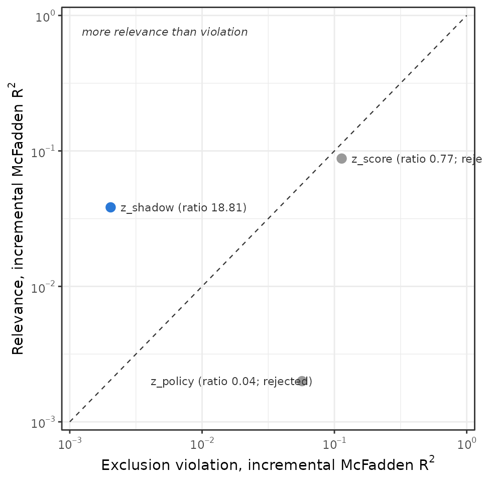

# Getting started with nonignorable

## The problem

An outcome \\Y\\ is observed for some rows and missing for others.
Whether a row is observed may depend on \\Y\\ itself. Applications that
look risky are declined, so their default is never seen. Patients who do
badly leave a trial, so their final measurement is never taken. A model
fitted to the observed rows then answers a question about the observed
rows. Carrying its answer over to the missing rows assumes the data are
missing at random (MAR).

The package asks two separate questions about such data.

1.  **Is there a shadow variable?** A shadow variable predicts \\Y\\ but
    has no effect of its own on whether \\Y\\ is observed. With one, the
    missing-data mechanism can be identified.
    [`shadow_screen()`](https://buecker.ms/nonignorable/reference/shadow_screen.md)
    reports, for each candidate, how strongly it predicts the outcome
    and how strongly it violates that exclusion restriction, on a common
    scale.

2.  **How far can the answer move?**
    [`sharp_scan()`](https://buecker.ms/nonignorable/reference/sharp_scan.md)
    drops identification and asks how much the conclusion can change if
    selection on \\Y\\ has a given strength. That strength is a bound
    \\e^\lambda\\ on the ratio of the response propensities of two rows
    with the same \\X\\ and different \\Y\\:

    \\\frac{P(R = 1 \mid X = x, Y = y)}{P(R = 1 \mid X = x, Y = y')} \le
    e^\lambda .\\

    At \\\lambda = 0\\ this is MAR. At \\e^\lambda = 2\\, an applicant
    who would repay may be up to twice as likely to be accepted as an
    otherwise identical applicant who would default, or the other way
    round.

The two tools rest on different assumptions and do not form one
procedure. The scan does not need a shadow variable, and passing the
screen does not make the scan unnecessary.

## Simulated data with a known truth

[`simulate_shadow()`](https://buecker.ms/nonignorable/reference/simulate_shadow.md)
draws data in which the bad outcome makes a row less likely to be
observed. `tilt = -1` means the ratio of propensities is \\e^1\\ in
every row. The data carry their own truth: `eta_obs` is \\P(Y = 1 \mid
X, R = 1)\\ and `obs_rate` is \\P(R = 1 \mid X)\\.

``` r

d <- simulate_shadow(5000, tilt = -1, seed = 1)
mean(d$observed)
#> [1] 0.5322
```

The candidates play known roles. `z_shadow` is a valid shadow variable.
`z_policy` acts only on selection. `z_score` acts on both, like a credit
bureau score that predicts default and that the lender also uses to
decide.

## Question 1: the screen

### Why a shadow variable

The observed rows alone cannot tell MAR from selection on \\Y\\: every
model fitted to them fits equally well whatever the missing outcomes
are. Some assumption has to fill the gap. A shadow variable \\Z\\ is one
such assumption. It must do two things:

- **relevance**: \\Z\\ predicts \\Y\\ given \\X\\;
- **exclusion**: \\Z\\ has no effect of its own on whether \\Y\\ is
  observed, once \\X\\ and \\Y\\ are known.

With such a \\Z\\, how selection depends on \\Y\\ can be estimated
instead of assumed. In lending, a candidate is a characteristic that the
lender recorded but did not use in the decision; in a trial, an earlier
measurement of the outcome.

### What the screen does

Exclusion cannot be checked directly. It conditions on \\Y\\, and \\Y\\
is missing in exactly the rows that matter. What the data can show is
whether a candidate is relevant at all, and whether it predicts
selection more strongly than it predicts the outcome. The second is the
mark of a variable that the selection uses directly, such as a score the
lender decides on. The screen measures both for every candidate, so that
unfit candidates are discarded before a model is built on one.

For each candidate it fits four logistic models: the outcome on \\X\\
and on \\X + Z\\ among the observed rows, and the response indicator on
\\X\\ and on \\X + Z\\ over all rows. **Relevance** is the gain in
McFadden \\R^2\\ from adding \\Z\\ to the outcome model. **Exclusion
violation** is the same gain in the response model. Both are on one
scale, so their **ratio** says how much better \\Z\\ predicts the
outcome than it predicts selection.

``` r

sc <- shadow_screen(d, outcome = "y", response = "observed",
                    covariates = c("x1", "x2"),
                    candidates = c("z_shadow", "z_policy", "z_score"))
sc
#> <shadow_screen> relevance vs exclusion violation, incremental McFadden R^2
#>   pass: relevance chi2/df >= 10 and ratio > 1
#>   numeric as linear terms: x1, x2, z_shadow, z_policy, z_score
#>  candidate relevance exclusion  ratio chi2/df verdict                
#>  z_shadow     0.0383   0.00204   18.8      55 pass                   
#>  z_policy      0.002     0.057 0.0351    2.87 reject: weak, exclusion
#>  z_score      0.0879     0.114  0.774     126 reject: exclusion
```

### Reading the result

A candidate passes when its relevance is clear, a likelihood-ratio
\\\chi^2\\ per degree of freedom of at least 10, and its ratio is
above 1. The plot shows each candidate with violation across and
relevance up. A shadow variable sits above the equality line, with more
relevance than violation. How far above is no test: the stronger the
selection on the outcome, the more a valid shadow variable predicts
selection too, through the outcome, and the closer it moves to the line.
A candidate well below the line is the warning sign.

``` r

plot(sc)
```



`z_shadow` passes with a ratio of 18.81. `z_score` is the most relevant
candidate but fails, with a ratio of 0.77. It predicts selection even
better than it predicts the outcome. That is the typical fate of a
bureau score in reject inference.

Numeric characteristics enter linearly by default. When selection cuts
hard at a threshold, as a lender declining every score below a cut-off,
use `numeric = "classes"`. The applications vignette shows why this
matters.

## Question 2: the scan

The scan bounds a rate over a portfolio of rows: here the unobserved
ones, and the rate of their own missing outcomes, \\E(Y \mid R = 0)\\.
In reject inference that is the default rate the rejected applicants
would show if they were granted. It is not the average of \\\eta(x) =
P(Y = 1 \mid X = x)\\ at their characteristics: under selection on the
outcome the rejected at a given \\x\\ differ from all applicants at that
\\x\\, and `unobserved = TRUE` says so. The scan needs two vectors at
those rows: \\\hat\eta\_{\mathrm{obs}}(x)\\ and \\\hat r(x)\\. Any
learner can produce them. Here we take the truth, to separate the logic
of the scan from estimation.

``` r

rej <- d[d$observed == 0, ]
s <- sharp_scan(rej$eta_obs, rej$obs_rate, threshold = 0.35, unobserved = TRUE)
s
#> <sharp_scan> sharp identified set for a rate under a propensity ratio <= exp(lambda)
#>   rows: 2339   aggregation: union 
#>   set for: the rows' own missing outcomes, E(Y | R = 0)
#>   lambda = 0 (model on observed rows): 0.208 
#>   lambda = 2 (propensity ratio 7.39): sharp [0.0225, 0.783], outer [-0.0341, 0.831]
#>   threshold 0.35 reached by
#>     sharp set:   lambda = 0.59 (propensity ratio 1.8) 
#>     outer band:  lambda = 0.59 (propensity ratio 1.8) 
#>   cap pi <= 1 at lambda = 2 binds in 73% of the rows entering the set
#>     for the lower bound, 19% for the upper
plot(s)
```



How to read the plot:

- **The point at \\e^\lambda = 1\\** is what a model on the observed
  rows asserts under MAR: a rate of 0.208 for the unobserved rows.
- **The filled band** is the sharp identified set. Every rate inside it
  is consistent with the data and with selection up to that strength,
  and no rate outside it is.
- **The dashed band** is the outer band, which shifts every row’s
  log-odds by \\\pm\lambda\\ and ignores the constraint that a response
  propensity is at most 1. For the unobserved rows that constraint says
  no more than that their own rate lies in \\\[0, 1\]\\, so the outer
  band can leave that range, as its lower end does here. The sharp set
  respects it. Where \\\hat r\\ is small the two are close; where it is
  large, the sharp set is much narrower; the applications vignette shows
  such a case.
- **The threshold** is the rate at which the decision changes, here
  0.35. The drop line marks the **flip point**, the smallest selection
  strength at which the other decision is no longer ruled out. Here it
  lies at \\e^\lambda \approx\\ 1.80.

The flip point is the number to report: “the conclusion that the
unobserved rows are better than 0.35 holds unless selection on the
outcome makes the propensity ratio exceed 1.80.”

Because the data are simulated, we know the truth. The simulator stores
\\\eta(x)\\ as `eta`, \\\eta\_{\mathrm{obs}}(x)\\ as `eta_obs` and
\\r(x)\\ as `obs_rate`, so by Bayes’ rule the true rate of the
unobserved rows is

``` r

with(rej, mean((eta - obs_rate * eta_obs) / (1 - obs_rate)))
#> [1] 0.4706904
```

It lies in the set at \\e^\lambda = e^1\\, the strength we simulated,
and there on its upper edge. The simulator gives every row the same,
extreme tilt, so the truth sits where the set ends:

``` r

b <- as.data.frame(s, lambda = 1)
c(lower = mean(b$lower), upper = mean(b$upper))
#>      lower      upper 
#> 0.07122292 0.47069036
```

## Sampling error

[`sharp_scan()`](https://buecker.ms/nonignorable/reference/sharp_scan.md)
treats its inputs as known. With estimated inputs, use
[`sharp_scan_ci()`](https://buecker.ms/nonignorable/reference/sharp_scan_ci.md).
It needs inputs for all rows, fitted out of fold, and the observed
outcomes.
[`crossfit_inputs()`](https://buecker.ms/nonignorable/reference/crossfit_inputs.md)
produces them for any learner passed as a function of a training frame
and new rows.

``` r

f <- ~ x1 + x2 + z_shadow + z_policy + z_score
inp <- crossfit_inputs(d, "observed",
  fit_eta = function(train, new) predict(glm(update(f, y ~ .), binomial, train),
                                         new, type = "response"),
  fit_r   = function(train, new) predict(glm(update(f, observed ~ .), binomial, train),
                                         new, type = "response"),
  seed = 1)
ci <- sharp_scan_ci(inp$eta_obs, inp$r, d$observed, d$y, target = "unobserved",
                    threshold = 0.35)
ci
#> <sharp_scan_ci> sharp set for a rate, debiased, with 90% confidence set
#>   rows: 5000   target: unobserved (2339 rows)
#>   r-hat < 0.01: 3 target rows, 0 observed rows; smallest r-hat observed 0.043
#>   lambda = 0: 0.199 [0.167, 0.231]
#>   lambda = 2 (propensity ratio 7.39): set [0.017, 0.755], confidence set [0, 0.802]
#>   threshold 0.35 reached by
#>     estimated set:        lambda = 0.651 (propensity ratio 1.92) 
#>     confidence set:       lambda = 0.515 (propensity ratio 1.67) 
#>     outer band (plug-in): lambda = 0.657 (propensity ratio 1.93) 
#>   cap pi <= 1 at lambda = 2 binds in 86% of the rows entering the set
#>     for the lower bound, 23% for the upper
plot(ci)
```



The estimate is debiased. The dotted lines are a 90% confidence set for
the identified set, pointwise in \\\lambda\\. A second drop line marks
where the confidence set reaches the threshold, here at \\e^\lambda
\approx\\ 1.67. That is the flip point the data can vouch for.

Two lines of the output deserve attention.

- **“r-hat \< 0.01”** counts rows with a very small estimated chance of
  being observed. Observed rows with small \\\hat r\\ get weight
  \\1/\hat r\\, so a few of them can carry much of the variance. The
  width of the confidence set should be read together with this count.
- **A warning about inverse weights** means the estimate left \\\[0,
  1\]\\ by a wide margin, typically because the response model separates
  some observed rows. Use a smoother or penalised response model, or
  `trim`.

## Comparing two portfolios

[`sharp_scan_contrast()`](https://buecker.ms/nonignorable/reference/sharp_scan_contrast.md)
scans the difference of rates between two portfolios chosen by \\X\\,
such as two treatment arms or two regions. Each portfolio is a whole
segment of rows, observed and unobserved alike. Its threshold is 0, no
difference.

``` r

k <- sharp_scan_contrast(inp$eta_obs, inp$r, d$observed, d$y,
                          target_a = d$x1 > 0, target_b = d$x1 <= 0,
                          labels = c("x1 > 0", "x1 <= 0"))
k
#> <sharp_scan_contrast> difference of rates x1 > 0 - x1 <= 0, debiased, with 90% confidence set
#>   rows: 5000   x1 > 0: 2461 rows   x1 <= 0: 2539 rows
#>   r-hat < 0.01: 3 target rows, 0 observed rows; smallest r-hat observed 0.043
#>   lambda = 0: 0.145 [0.109, 0.181]
#>   lambda = 2 (propensity ratio 7.39): set [-0.181, 0.514], confidence set [-0.222, 0.555]
#>   difference 0 reached by
#>     estimated set:        lambda = 0.817 (propensity ratio 2.26) 
#>     confidence set:       lambda = 0.604 (propensity ratio 1.83) 
#>     outer band (plug-in): lambda = 0.665 (propensity ratio 1.94)
```

## A mean instead of a rate

For an outcome that is not binary,
[`sharp_scan_mean()`](https://buecker.ms/nonignorable/reference/sharp_scan_mean.md)
takes, per row, a grid of conditional quantiles of \\Y\\ given \\R = 1\\
and \\X\\.
[`quantile_grid()`](https://buecker.ms/nonignorable/reference/quantile_grid.md)
builds it from a
[`quantreg::rq`](https://rdrr.io/pkg/quantreg/man/rq.html) fit, from any
function of the levels, or from draws.

``` r

dc <- simulate_shadow(3000, tilt = -1, outcome = "continuous", seed = 1)
obs <- dc[dc$observed == 1, ]
mis <- dc[dc$observed == 0, ]
m <- lm(y ~ x1 + x2 + z_shadow + z_policy + z_score, data = obs)
q <- quantile_grid(function(tau, newdata)
  outer(predict(m, newdata), quantile(residuals(m), tau, names = FALSE), "+"),
  mis, K = 100)
sm <- sharp_scan_mean(q, mis$obs_rate, threshold = 0.5, unobserved = TRUE)
plot(sm)
```



Like
[`sharp_scan()`](https://buecker.ms/nonignorable/reference/sharp_scan.md),
this treats its inputs as known. For a debiased estimate with a
confidence set, for the mean over all rows, a segment chosen by \\X\\,
or the missing outcomes (`target = "unobserved"`), use
[`sharp_scan_mean_ci()`](https://buecker.ms/nonignorable/reference/sharp_scan_mean_ci.md)
with inputs from
[`crossfit_quantiles()`](https://buecker.ms/nonignorable/reference/crossfit_quantiles.md);
the applications vignette shows it on the CD4 counts of a clinical
trial.

## The distribution function and quantiles

A mean can hide where the distribution moves.
[`sharp_scan_cdf()`](https://buecker.ms/nonignorable/reference/sharp_scan_cdf.md)
scans \\P(Y \le t)\\ at each value of a grid, as the rate of the binary
outcome \\1(Y \le t)\\, with the same assumption and the same debiased
estimate as
[`sharp_scan_ci()`](https://buecker.ms/nonignorable/reference/sharp_scan_ci.md).
[`crossfit_cdf()`](https://buecker.ms/nonignorable/reference/crossfit_cdf.md)
fits \\P(Y \le t \mid R = 1, X)\\ as one classification per \\t\\, with
the column `z` holding \\1(Y \le t)\\.

``` r

tg <- seq(-3, 2, by = 0.25)
cf <- crossfit_cdf(dc, "observed", "y", tg,
  fit_eta = function(train, new) predict(glm(update(f, z ~ .), binomial, train),
                                         new, type = "response"),
  fit_r   = function(train, new) predict(glm(update(f, observed ~ .), binomial, train),
                                         new, type = "response"),
  seed = 1)
kc <- sharp_scan_cdf(cf$eta_t, cf$r, dc$observed, dc$y, t = tg, lambda = 0.5,
                     target = "unobserved")
plot(kc)
```



``` r

quantile(kc, c(0.25, 0.5, 0.75))
#>   prob       point lower upper
#> 1 0.25 -1.28519346 -1.75 -0.75
#> 2 0.50 -0.04444012 -0.75  0.50
#> 3 0.75  1.32165743  0.75  1.75
```

The set and the confidence set hold for each \\t\\ separately: no single
law need reach the upper curve at every \\t\\, and the confidence sets
are not a band. The quantile bounds come from inverting the two curves;
on the grid they are widened outwards, so a coarse grid makes them
wider, never narrower.

## Plots with ggplot2

Every [`plot()`](https://rdrr.io/r/graphics/plot.default.html) above is
base graphics, so the package needs nothing beyond R itself to draw. If
ggplot2 is installed,
[`autoplot()`](https://ggplot2.tidyverse.org/reference/autoplot.html)
draws the same plots as ggplot objects: the sets, the outer band, the
confidence set, the point under MAR, the threshold with its flip, and,
for the screen, the equality line, hollow points where the violation is
at noise level and grey points for rejected candidates. The legend sits
below the panel. Add to the result as to any ggplot.

``` r

library(ggplot2)
autoplot(ci) + labs(title = "Rejected applications")
```



``` r

autoplot(sc) + theme_bw()
```



## Further reading

[`vignette("applications", package = "nonignorable")`](https://buecker.ms/nonignorable/articles/applications.md)
applies the tools to two real cases side by side. On Lending Club 2014
the coding of the screen matters, and the main finding does not survive
MAR once sampling error is counted. In the ACTG 175 trial a comparison
of treatment arms survives moderate selection.
