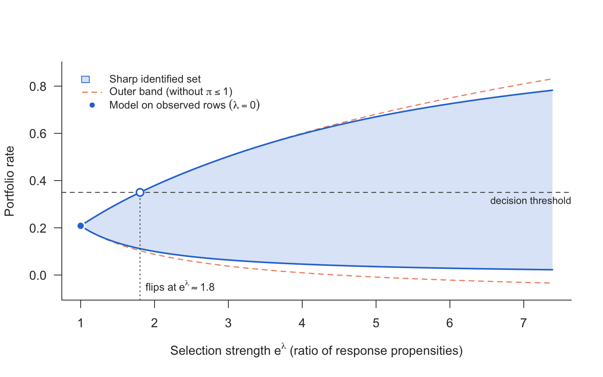
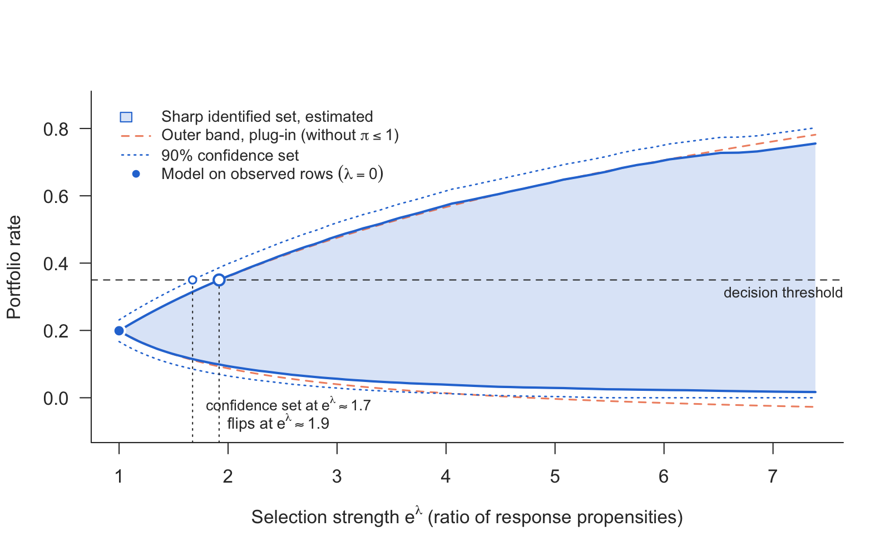
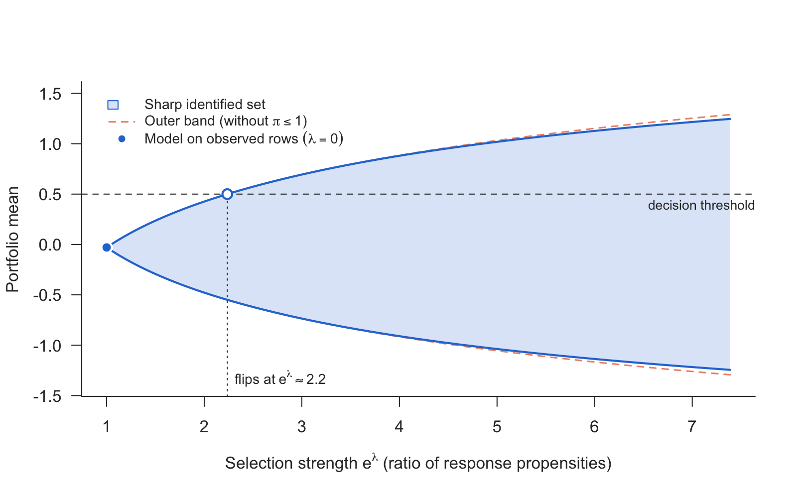
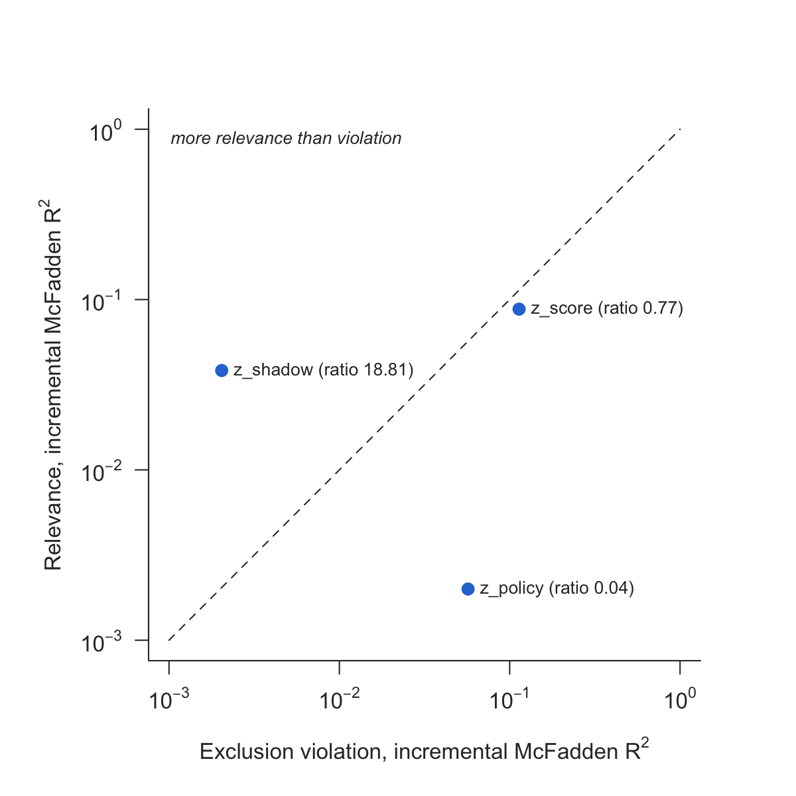

# nonignorable

[](https://doi.org/10.5281/zenodo.24079954)

If a binary outcome is missing not at random, as defaults are for
rejected credit applications, every model fitted on the observed rows
silently asserts *one* value for how observability depends on the
outcome. Nothing in the data selects it. `nonignorable` provides two
tools for two different questions:

- **[`shadow_screen()`](https://buecker.ms/nonignorable/reference/shadow_screen.md)**:
  *is this variable fit to serve as a shadow variable?* It puts
  relevance for the outcome against violation of the exclusion
  restriction, both as incremental McFadden R², on one scale.
- **[`sharp_scan()`](https://buecker.ms/nonignorable/reference/sharp_scan.md)**
  and
  **[`sharp_scan_mean()`](https://buecker.ms/nonignorable/reference/sharp_scan_mean.md)**:
  *how far can the answer move?* They return the sharp identified set
  under a bound e^λ on the ratio of response propensities between
  outcome values (a risk ratio, not an odds ratio), with no shadow
  variable needed. The first handles a binary outcome in closed form,
  the second the mean of any outcome from a grid of conditional
  quantiles.

The two rest on different assumptions and are **not** two halves of one
procedure.

## Installation

``` r

# install.packages("remotes")
remotes::install_github("mchlbckr/nonignorable")
```

## The scan

The scan takes two numeric vectors evaluated at the rows of interest:
η̂\_obs(x) = P(Y = 1 \| X = x, R = 1) and the *conditional* observation
rate r̂(x) = P(R = 1 \| X = x). Any learner can produce them. The set is

\\\mathcal H\_\lambda(x) = \big\[\max\\\mathrm{expit}(\ell-\lambda),\\
r\eta\_{\mathrm{obs}}\\,\\ \min\\\mathrm{expit}(\ell+\lambda),\\
r\eta\_{\mathrm{obs}} + 1 - r\\\big\],\quad \ell =
\mathrm{logit}\\\eta\_{\mathrm{obs}},\\

the outer band intersected with the worst-case bounds.

``` r

library(nonignorable)
d   <- simulate_shadow(5000, tilt = -1, seed = 1)
rej <- d[d$observed == 0, ]
s   <- sharp_scan(rej$eta_obs, rej$obs_rate, threshold = 0.35, unobserved = TRUE)
s
plot(s)
```



Sensitivity curve

The sharp set is never wider than the outer band. Where r̂ is small, as
for rejected applications, the two are close; the sharp set is narrower
only where a worst-case bound cuts the band. With `unobserved = TRUE`
the set is for the rejected rows’ own default rate, E(Y \| R = 0),
rather than for the average of η(x) at their characteristics; under
selection on the outcome the two differ. The default aggregation
averages each row’s own bounds, which is sharp under the pointwise
assumption. `aggregate = "common"` adds the assumption of one tilt for
all rows. That set is narrower but is bounded by the most extreme rows,
so with estimated inputs it inherits their estimation error. The help
page explains how to read it.

## Sampling error

[`sharp_scan()`](https://buecker.ms/nonignorable/reference/sharp_scan.md)
treats its inputs as known.
[`sharp_scan_ci()`](https://buecker.ms/nonignorable/reference/sharp_scan_ci.md)
adds a confidence set for the binary scan, after Semenova (2025): the
binding piece of each row is chosen from models fitted without it, and
an orthogonal signal of that piece is averaged instead of its plug-in
value, which is biased towards the inside of the set. It needs
cross-fitted inputs for all rows and the observed outcomes;
[`crossfit_inputs()`](https://buecker.ms/nonignorable/reference/crossfit_inputs.md)
produces them for any learner you pass as a function.

``` r

f   <- ~ x1 + x2 + z_shadow + z_policy + z_score
inp <- crossfit_inputs(d, "observed",
  fit_eta = function(train, new) predict(glm(update(f, y ~ .), binomial, train),
                                         new, type = "response"),
  fit_r   = function(train, new) predict(glm(update(f, observed ~ .), binomial, train),
                                         new, type = "response"),
  seed = 1)
ci  <- sharp_scan_ci(inp$eta_obs, inp$r, d$observed, d$y, target = "unobserved",
                      threshold = 0.35)
plot(ci)
```



Sensitivity curve with confidence set

The confidence set covers the identified set, pointwise in λ.
[`sharp_scan_mean_ci()`](https://buecker.ms/nonignorable/reference/sharp_scan_mean_ci.md)
does the same for the mean of a non-binary outcome, with quantile grids
cross-fitted by
[`crossfit_quantiles()`](https://buecker.ms/nonignorable/reference/crossfit_quantiles.md).

To compare two portfolios chosen by X, such as the arms of a trial,
[`sharp_scan_contrast()`](https://buecker.ms/nonignorable/reference/sharp_scan_contrast.md)
gives the sharp set for the difference of their rates with a confidence
set. It also reports the selection strength from which “no difference”
can no longer be ruled out.
[`sharp_scan_mean_contrast()`](https://buecker.ms/nonignorable/reference/sharp_scan_mean_contrast.md)
does the same for the difference of two means.

``` r

k <- sharp_scan_contrast(inp$eta_obs, inp$r, d$observed, d$y,
                          target_a = d$x1 > 0, target_b = d$x1 <= 0)
```

## The scan for a mean

For an outcome that is not binary,
[`sharp_scan_mean()`](https://buecker.ms/nonignorable/reference/sharp_scan_mean.md)
takes, per row, a grid of conditional quantiles of Y given R = 1 and X,
together with r̂(x). It returns the sharp set for the mean under the same
assumption. Binary input reproduces
[`sharp_scan()`](https://buecker.ms/nonignorable/reference/sharp_scan.md)
exactly.

``` r

dc  <- simulate_shadow(3000, tilt = -1, outcome = "continuous", seed = 1)
q   <- obs_quantiles(dc, K = 200)       # n x K, levels (k - 1/2)/K
rej <- dc$observed == 0
sm  <- sharp_scan_mean(q[rej, ], dc$obs_rate[rej], threshold = 0.5, unobserved = TRUE)
plot(sm)
```



Sensitivity curve for a mean

[`obs_quantiles()`](https://buecker.ms/nonignorable/reference/simulate_shadow.md)
knows the simulator’s truth. On real data,
[`quantile_grid()`](https://buecker.ms/nonignorable/reference/quantile_grid.md)
builds the grid from a fitted model. It accepts a
[`quantreg::rq`](https://rdrr.io/pkg/quantreg/man/rq.html) fit (refitted
at the K levels), any `function(tau, newdata)`, or a matrix of draws
from a distributional model. It sorts crossing quantile curves and
reports how far that moved them.

``` r

obs <- dc[dc$observed == 1, ]
fq  <- quantreg::rq(y ~ x1 + x2 + z_shadow + z_policy + z_score, data = obs)
q   <- quantile_grid(fq, dc[rej, ], K = 200)
```

## The distribution function and quantiles

[`sharp_scan_cdf()`](https://buecker.ms/nonignorable/reference/sharp_scan_cdf.md)
scans P(Y ≤ t), or P(Y ≤ t \| R = 0), at each value of a grid, as the
rate of the binary outcome 1(Y ≤ t), with a debiased estimate and a
confidence set at each t.
[`quantile()`](https://rdrr.io/r/stats/quantile.html) turns the bounds
into bounds for quantiles. The sets hold for each t separately, not as a
band.
[`crossfit_cdf()`](https://buecker.ms/nonignorable/reference/crossfit_cdf.md)
fits P(Y ≤ t \| R = 1, X) as one classification per t.

``` r

tg <- seq(-2, 2, by = 0.25)
cf <- crossfit_cdf(dc, "observed", "y", tg,
  fit_eta = function(train, new) predict(glm(update(f, z ~ .), binomial, train),
                                         new, type = "response"),
  fit_r   = function(train, new) predict(glm(update(f, observed ~ .), binomial, train),
                                         new, type = "response"),
  seed = 1)
kc <- sharp_scan_cdf(cf$eta_t, cf$r, dc$observed, dc$y, t = tg, lambda = 0.5)
quantile(kc, c(0.25, 0.5, 0.75))
```

## The screen

The scan needs no shadow variable; with one, the selection on the
outcome can be estimated instead of bounded. A shadow variable predicts
the outcome (relevance) but has no effect of its own on whether the
outcome is observed (exclusion). Exclusion cannot be checked directly,
because it conditions on the missing outcome. The screen measures what
the data can show: whether a candidate is relevant, and whether it
predicts selection more strongly than the outcome, the mark of a
variable the selection uses directly. For each candidate it compares the
gain in McFadden R² from adding it to the outcome model (observed rows)
and to the response model (all rows), and passes candidates with clear
relevance and more relevance than violation.

``` r

sc <- shadow_screen(d, outcome = "y", response = "observed",
                    covariates = c("x1", "x2"),
                    candidates = c("z_shadow", "z_policy", "z_score"))
sc
plot(sc)
```



Screen

Numeric characteristics enter linearly by default. If the selection uses
one through a threshold, as a lender declining every score below a
cut-off, a linear term cannot represent the step and understates the
exclusion violation. The screen warns when it sees the trace of such a
rule: values on more than 1% of the sample that never occur among the
observed rows. `numeric = "classes"` then codes every numeric
characteristic as about ten classes of equal mass, plus a class for
values outside the observed range:

``` r

shadow_screen(d, "y", "observed", c("x1", "x2"), "z_score", numeric = "classes")
```

The classes come from
[`screen_classes()`](https://buecker.ms/nonignorable/reference/screen_classes.md),
which cuts only between distinct values. Quantile classes from
[`cut()`](https://rdrr.io/r/base/cut.html) put boundaries on heaped
values, such as loan amounts on round numbers, and then assign those
rows by convention; `attr(screen_classes(x), "heaping")` reports how
many. Call it yourself for known cut-offs or other class counts and pass
factors.

## Vignettes

- [`vignette("nonignorable")`](https://buecker.ms/nonignorable/articles/nonignorable.md):
  the tools on simulated data with a known truth, and how to read their
  output.
- [`vignette("applications")`](https://buecker.ms/nonignorable/articles/applications.md):
  reject inference on Lending Club 2014 and dropout in the ACTG 175
  trial, side by side, including a comparison of treatment arms with
  [`sharp_scan_contrast()`](https://buecker.ms/nonignorable/reference/sharp_scan_contrast.md).

## Scope

The scan covers a binary outcome in closed form, the **mean** of any
outcome with a finite mean, and the distribution function and quantiles,
pointwise in t. It offers no bands uniform in t. The screen takes a
binary outcome directly, a numeric one through an ordinal model on
classes and a categorical one through an ordinal or multinomial model;
it measures relevance and does not certify identification. Covariates,
learners and sample size are unrestricted. The package fits neither
η_obs nor r:
[`sharp_scan()`](https://buecker.ms/nonignorable/reference/sharp_scan.md)
and
[`sharp_scan_mean()`](https://buecker.ms/nonignorable/reference/sharp_scan_mean.md)
treat them as known, and the `_ci` functions take cross-fitted
predictions from your own learner. It ships no outside data: examples
and tests run on
[`simulate_shadow()`](https://buecker.ms/nonignorable/reference/simulate_shadow.md).

## License

MIT
